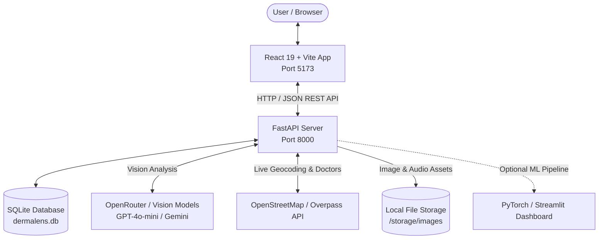

# DermaLens AI 🔬
> **Intelligent, Explainable Skin Health Screening & Lesion Monitoring Platform**

DermaLens AI is an AI-assisted skin health screening platform designed to help users track skin lesions, compare changes over time, analyze multi-view images using intelligent computer vision pipelines, receive localized explanations in regional languages, and locate nearby professional healthcare providers.

---

## 🌟 Key Features

1. **AI Skin Screening Pipeline**: Upload single or multi-angle photos (up to 5 images per session) for automated evaluation of lesion shape, asymmetry, border irregularity, color variation, and surface texture.
2. **Real Computer Vision Quality Checks**: Validates resolution, estimates blur via Laplacian variance, checks brightness and contrast, and computes cryptographic SHA-256 hashes for duplicate image detection.
3. **Interactive Doctor Locator Map**: Locate professional dermatologists, skin clinics, and hospitals near you with a dynamic Leaflet map powered by OpenStreetMap Overpass API, supporting geocoding address searches, distance calculations, and contact routing.
4. **Multilingual Localized Explanations**: Complete localized translations across **English, Hindi, Telugu, Tamil, Malayalam, and Kannada**.
5. **Narrative Voice Explanations**: Dynamic text-to-speech engine using Google Text-to-Speech (gTTS) to generate localized MP3 audio summaries for accessibility.
6. **RAG Citations & Lens AI Assistant**: Retrieve clinical literature citations (e.g., AAD, British Journal of Dermatology guidelines) and ask interactive questions about screening results.
7. **Printable Doctor Summary**: Instantly generate structured clinical reports summarizing ABCDE parameters and quality metrics for healthcare consultations.
8. **Skin Story Timeline & Baseline Tracking**: Chronological tracking of lesion evolutions over time with side-by-side comparative views.
9. **Optional ML Training & Evaluation Suite**: Built-in PyTorch pipeline to train and benchmark Custom CNNs, ResNet-18, and ResNet-50 backbones with a companion Streamlit model dashboard.

---

## 📐 System Architecture



### 💻 Frontend Architecture (React + Vite)
- **Framework**: React 19 & Vite 8 with Hot Module Replacement (HMR).
- **Icons**: Lucide React for consistent SVG icons.
- **Design System**: Vanilla CSS with tailored HSL tokens, glassmorphism, responsive navigation pill track, dark mode support, and micro-animations.
- **Mapping**: Leaflet with OpenStreetMap tiles for interactive clinic searches.

### ⚙️ Backend Architecture (FastAPI + Python)
- **Framework**: FastAPI (asynchronous ASGI framework) with Uvicorn.
- **Database**: SQLite with connection-pooling and row factories (`dermalens.db`).
- **Vision Pipeline**: OpenRouter OpenAI-compatible endpoint supporting vision models (`openai/gpt-4o-mini`, `google/gemini-2.5-flash`, etc.).
- **Audio Generation**: `gTTS` generating localized audio files served via static mounts.
- **Image Processing**: Pillow (`PIL`) & NumPy for image validation, quality metrics, and duplicate detection.

---

## 🛠️ Local Development Setup

### Prerequisites
- **Node.js**: v18+ (tested on v20+)
- **Python**: v3.10+ (tested on v3.12)
- **OpenRouter API Key** (optional for live AI analysis, get one at [openrouter.ai/keys](https://openrouter.ai/keys))

---

### Step 1: Clone & Configure Environment

1. **Root Frontend `.env`**:
   Copy `.env.example` to `.env`:
   ```bash
   cp .env.example .env
   ```
   *Contents of `.env`:*
   ```env
   VITE_API_BASE_URL=http://localhost:8000
   ```

2. **Backend `.env`**:
   Copy `backend/.env.example` to `backend/.env`:
   ```bash
   cp backend/.env.example backend/.env
   ```
   *Contents of `backend/.env`:*
   ```env
   OPENROUTER_API_KEY=your-openrouter-api-key-here
   OPENROUTER_MODEL=openai/gpt-4o-mini
   CORS_ORIGINS=http://localhost:5173,http://127.0.0.1:5173,http://localhost:3000,http://127.0.0.1:3000,http://localhost:8000,http://127.0.0.1:8000
   ```

---

### Step 2: Backend Setup (FastAPI)

1. Open a terminal in the `backend/` directory:
   ```bash
   cd backend
   ```

2. Create and activate a Python virtual environment:
   - **Windows (PowerShell)**:
     ```powershell
     python -m venv .venv
     .\.venv\Scripts\Activate.ps1
     ```
   - **Linux / macOS**:
     ```bash
     python3 -m venv .venv
     source .venv/bin/activate
     ```

3. Install required Python dependencies:
   ```bash
   pip install -r requirements.txt
   ```

4. Initialize the SQLite database:
   ```bash
   python -c "from app.database import init_db; init_db(); print('Database initialized successfully!')"
   ```

5. Start the backend server:
   ```bash
   uvicorn app.main:app --host 127.0.0.1 --port 8000 --reload
   ```
   *The backend will be available at [http://127.0.0.1:8000](http://127.0.0.1:8000).*

---

### Step 3: Frontend Setup (React + Vite)

1. Open a second terminal in the project root:
   ```bash
   npm install
   ```

2. Start the Vite development server:
   ```bash
   npm run dev
   ```
   *The web application will be live at [http://localhost:5173/](http://localhost:5173/).*

---

## 🌐 Application URLs Quick Reference

| Service | Address | Description |
| :--- | :--- | :--- |
| **Web Application** | [http://localhost:5173/](http://localhost:5173/) | Main user interface (Screening, Timeline, Doctor Locator) |
| **Backend API** | [http://127.0.0.1:8000/](http://127.0.0.1:8000/) | FastAPI root service |
| **Swagger UI Docs** | [http://127.0.0.1:8000/docs](http://127.0.0.1:8000/docs) | Interactive API exploration and testing |
| **Health Check** | [http://127.0.0.1:8000/api/health](http://127.0.0.1:8000/api/health) | API and model configuration health probe |

---

## 🔌 Complete API Endpoints Reference

### 1. Health & Core
| Method | Endpoint | Description |
| :--- | :--- | :--- |
| `GET` | `/api/health` | Returns backend health, model configuration, and provider status. |

### 2. Multi-Image Screening Pipeline
| Method | Endpoint | Description |
| :--- | :--- | :--- |
| `POST` | `/api/screening/upload` | Upload 1 to 5 images per session. Runs format validation, Laplacian blur check, lighting/contrast checks, and SHA-256 duplicate hashing. |
| `POST` | `/api/screening/analyze` | Executes multi-image vision analysis via OpenRouter and organizes dataset records. |
| `GET` | `/api/screening/{session_id}/result` | Retrieves session analysis results, ABCDE features, image URLs, and quality flags. |
| `POST` | `/api/screening/image/metadata` | Updates image perspective angle (Front, Left, Right, Close-up, etc.) or image type. |
| `GET` | `/history?guest_id={guest_id}` | Retrieves past screening sessions for a specific browser session or user ID. |
| `GET` | `/api/dataset/stats` | Returns structured metrics on classified dataset images and camera angles. |

### 3. Localization & Multimodal Explanations
| Method | Endpoint | Description |
| :--- | :--- | :--- |
| `POST` | `/api/explanation` | Translates screening findings and scenes into Hindi, Telugu, Tamil, Malayalam, Kannada, or English. |
| `POST` | `/api/explanation/audio` | Generates a localized speech audio file (`.mp3`) via `gTTS` and returns its streaming URL. |
| `POST` | `/api/explanation/video` | Returns video walkthrough media assets for patient education. |

### 4. Assistant & Clinical Knowledge
| Method | Endpoint | Description |
| :--- | :--- | :--- |
| `POST` | `/api/lens-ai/ask` | Context-aware Q&A assistant explaining current screening results and skin health topics. |
| `POST` | `/api/rag/explain` | Queries clinical dermatology guidelines with verifiable medical citations. |
| `POST` | `/api/reports/doctor` | Generates a clinical summary object ready for export or doctor visits. |

### 5. Doctor Locator (Live OpenStreetMap)
| Method | Endpoint | Description |
| :--- | :--- | :--- |
| `GET` | `/api/doctors/nearby` | Queries OpenStreetMap Overpass API for dermatologists, clinics, and hospitals within a given radius (`radius`, `latitude`, `longitude`, `address`, `specialization`, `sort`, `rating`). |

### 6. Lesions & Longitudinal Tracking
| Method | Endpoint | Description |
| :--- | :--- | :--- |
| `GET` | `/api/lesions` | Lists all tracked lesions. |
| `POST` | `/api/lesions` | Creates a new lesion with an initial baseline photograph and AI analysis. |
| `GET` | `/api/lesions/{lesion_id}` | Retrieves a specific lesion and its full historical scan record. |
| `POST` | `/api/lesions/{lesion_id}/scans` | Uploads a follow-up image, evaluates evolution vs baseline, and flags conflicting signs. |
| `GET` | `/api/lesions/{lesion_id}/report` | Generates historical progression reports for clinical consultations. |

---

## 🧪 Optional PyTorch ML Pipeline

DermaLens AI includes an optional standalone machine learning suite for training and comparing deep learning architectures on dermascopic datasets (e.g., HAM10000):

- **Supported Models**:
  - Custom CNN Baseline
  - ResNet-18 (Transfer Learning)
  - Pretrained ResNet-50 Vision Backbone

### Running the ML Suite:
1. Install extra ML dependencies:
   ```bash
   pip install -r backend/requirements-ml.txt
   ```
2. Train and benchmark models:
   ```bash
   python -m ml.train_compare --data-dir ../data/skin-dataset --epochs 10
   ```
3. Launch the interactive Streamlit Model Comparison Dashboard:
   ```bash
   streamlit run backend/ml/dashboard.py
   ```
4. Query local model endpoints:
   - `GET /api/ml/status` — Model checkpoint status.
   - `GET /api/ml/metrics` — Classification accuracy, precision, recall, and confusion matrix.
   - `POST /api/ml/predict` — Local offline inference with trained PyTorch weights.

---

## 🛡️ Medical & Safety Disclaimer

> [!IMPORTANT]
> **DermaLens AI is an educational screening support and monitoring tool, NOT a diagnostic medical device.**
> 
> - The AI-assisted indications (LOW, MODERATE, HIGH, UNCERTAIN) represent pattern-matching probabilities and visual assessments.
> - An AI indication of "LOW" does not guarantee that a spot is benign, and an indication of "HIGH" does not confirm cancer.
> - Always consult a board-certified dermatologist or qualified healthcare provider for any new, changing, bleeding, itching, or non-healing skin lesion.
